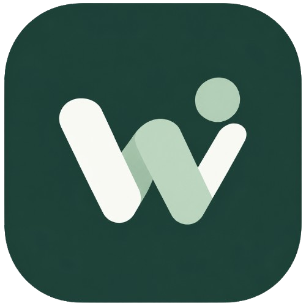

# Wall o' Pay 🌿📱

<div align="center">



### *Your Money, Under Your Control*
**Modern, Lightning-Fast & Offline-First Personal Finance Tracker**

[](https://flutter.dev)
[](https://dart.dev)
[](https://drift.simonbinder.eu/)
[](https://firebase.google.com/)
[](LICENSE)
[](CHANGELOG.md)

[🌐 Visit Landing Page](https://username.github.io/wall_o_pay/) • [📥 Download Latest APK](https://github.com/username/wall_o_pay/releases/latest) • [📋 Changelog](CHANGELOG.md)

</div>

---

## 🌟 Overview

**Wall o' Pay** is a modern personal finance and cashflow tracker built for speed, privacy, and delight. Engineered with an **offline-first** architecture powered by Drift SQLite, the application works instantaneously without requiring an internet connection. When needed, users can seamlessly synchronize and back up their financial data to Firebase.

---

## ✨ Key Features

- ⚡ **Offline-First & Instantaneous:** Transactions and calculations are handled locally on-device with Drift SQLite. Zero network latency, instant launches, and full reliability anywhere.
- 🔔 **Auto-Detected Transaction Inbox with Confirmation:** Background notification listener detects transactions from Indonesian banks and e-wallets (BCA, Mandiri Livin', BRImo, BNI, GoPay, OVO, DANA, ShopeePay) and queues them as pending drafts. Users can review, adjust category/amount, and confirm before recording.
- 💵 **Comprehensive Cashflow Logging:** Record income and expenses effortlessly with custom categories, dates, remarks, and receipt photo attachments.
- 🎯 **Dedicated Savings Goals:** Set targets for emergency funds, gadgets, or dream vacations. Make step-by-step deposits and track progress percentages in real time.
- 📊 **Category Budgeting:** Set hard monthly limits per spending category. Visual progress bars alert you before overspending occurs.
- 📈 **Interactive Insights & Analytics:** Understand spending habits through responsive pie charts and trend graphs powered by `fl_chart`.
- ☁️ **Flexible Cloud Sync:** Enjoy full anonymity with 100% offline local storage, or link Google / Email accounts via Firebase Authentication to securely sync records across devices.
- 📁 **Data Export:** Export transaction records anytime into standard CSV and JSON formats.
- 🎨 **Curated Aesthetic:** Calming Deep Forest Green (`#1E4238`) and Sage palette designed with Material 3 and seamless Dark Mode / Light Mode support.
- 🤝 **Debts & Split Bills:** Track who owes whom, record partial or full debt payments, and easily split restaurant or group expenses among friends with one-tap transaction logging.
- 📄 **Exportable PDF Financial Reports:** Generate beautiful, printable PDF financial statements for any custom time period or month, complete with category summaries and transaction details.
- ⏰ **Smart Local Notifications & Daily Reminders:** Set customizable daily log reminders and receive automatic threshold alerts when category spending crosses 80% and 100% of budgeted limits.
- ⚡ **Quick Transaction Templates:** Save recurring expense templates (e.g. daily coffee, routine lunch) and log them with a single tap.
- 🎯 **Needs vs. Wants Allocation:** Mark expenses as Needs or Wants to gain immediate visibility into essential vs. lifestyle spending on the Insight tab.
- 🌐 **Multilingual Localization:** Seamlessly switch between English and Bahasa Indonesia within the app settings.

---

## 🛠️ Technology Stack

| Layer | Technology |
| :--- | :--- |
| **Framework** | Flutter (Stable Channel) |
| **Language** | Dart 3 |
| **State Management** | Riverpod (`flutter_riverpod`) |
| **Local Database** | Drift (SQLite) with `drift_flutter` |
| **Cloud & Auth** | Firebase Core, Firebase Auth, Cloud Firestore |
| **Data Visualization** | `fl_chart` |
| **Typography & Icons** | Google Fonts (Plus Jakarta Sans) & Cupertino / Material Icons |
| **CI / CD Automation** | GitHub Actions (Auto APK Compilation & GitHub Release) |
| **Landing Page** | HTML5, Modern CSS3, Vanilla JavaScript (GitHub Pages in `/docs`) |

---

## 🚀 Getting Started

### Prerequisites
- [Flutter SDK](https://docs.flutter.dev/get-started/install) (version 3.47.0 or higher)
- [Dart SDK](https://dart.dev/get-dart) (version 3.13.0 or higher)
- Android Studio / VS Code with Flutter & Dart extensions
- Android device or emulator running Android 8.0+ (API 26+)

### Installation & Run

1. **Clone the repository:**
   ```bash
   git clone https://github.com/username/wall_o_pay.git
   cd wall_o_pay
   ```

2. **Install dependencies:**
   ```bash
   flutter pub get
   ```

3. **Generate Drift Database code (if modifying models):**
   ```bash
   dart run build_runner build --delete-conflicting-outputs
   ```

4. **Launch the application:**
   ```bash
   flutter run
   ```

---

## 📦 Automated Release Pipeline

This repository includes a continuous delivery workflow via GitHub Actions ([`.github/workflows/release.yml`](.github/workflows/release.yml)):
1. Every time a new version is bumped in `pubspec.yaml` and documented in `CHANGELOG.md`.
2. Pushing commits to the `main` branch triggers the pipeline to:
   - Extract the release notes for the new version from `CHANGELOG.md`.
   - Build a production-ready Android APK (`flutter build apk --release`).
   - Create a new **GitHub Release** automatically, complete with the compiled APK attached for instant download.

---

## 📄 License

This project is licensed under the [MIT License](LICENSE) © 2026 Wall o' Pay.
